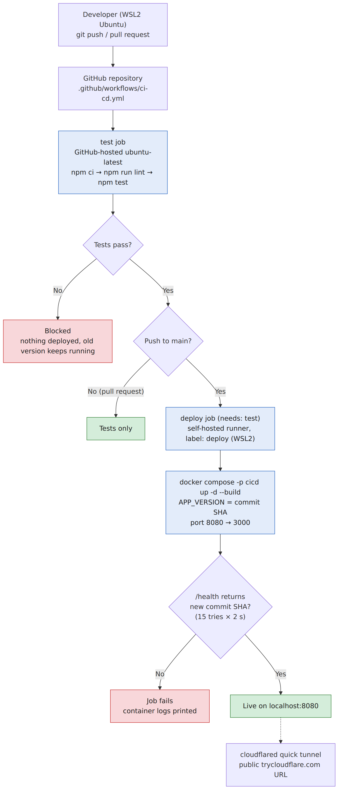

# ITSD 85 Lab <no>: Automated CI/CD Pipeline

Student(s): Kurt Vincent M. Velasco | Section: BSIT4Cx | Instructor: Rinante Buntod

## What this project does

A small Express app with a GitHub Actions pipeline. Pushing to `main` runs lint and tests on GitHub's cloud runner. If they pass, a self-hosted runner (WSL2) rebuilds the Docker container on port 8080. A Cloudflare tunnel can expose it publicly.

This replaces the lab's VirtualBox VM with WSL2 Ubuntu. WSL2 is both the dev machine and the deployment server.

### Endpoints

| Route | Description |
|-------|-------------|
| `GET /` | HTML page showing the deployed version |
| `GET /health` | `{ "status": "ok", "version": "<APP_VERSION>" }` |
| `GET /api/add?a=1&b=2` | `{ "result": 3 }`; returns 400 if `a` or `b` is not a number |
| `GET /api/subtract?a=3&b=2` | `{ "result": 1 }`; returns 400 if `a` or `b` is not a number |

### Project layout

```
.github/workflows/ci-cd.yml   test + deploy pipeline
src/app.js                    Express app
src/server.js                 server entry point
test/app.test.js              tests (node:test)
Dockerfile
compose.yaml
eslint.config.js
docs/                         pipeline diagram, screenshots, paper
```

## Pipeline diagram



```
WSL2 (dev)  --git push-->  GitHub
                             |
                   test job (GitHub-hosted: npm ci, lint, test)
                             |
                  fail --> blocked, nothing deployed
                             | pass (push to main only)
                   deploy job (self-hosted runner in WSL2)
                             |
                   docker compose up --build (8080 -> 3000)
                             |
                   health check: /health returns commit SHA
                             |
                   cloudflared tunnel -> public trycloudflare.com URL
```

## How to run locally

```bash
npm install
npm run dev      # http://localhost:3000, restarts on file changes
npm run lint     # no output means clean
npm test         # 5 tests should pass
```

With Docker:

```bash
docker compose -p cicd up -d --build
curl localhost:8080/health
docker compose -p cicd down
```

The app is served on `http://localhost:8080`. Set `APP_VERSION` to change the version shown (the pipeline uses the commit SHA):

```bash
APP_VERSION=1.0.0 docker compose -p cicd up -d --build
```

## How the deployment works

Defined in `.github/workflows/ci-cd.yml`.

- **test job** (GitHub-hosted `ubuntu-latest`): `npm ci`, `npm run lint`, `npm test`. Runs on pushes and pull requests to `main`.
- **deploy job** (self-hosted runner labelled `deploy`): runs only on pushes to `main`, after `test` passes (`needs: test`). It runs `docker compose up -d --build`, then polls `/health` until it reports the new commit SHA. If the check fails, it prints the container logs and the job fails.

Pull requests run tests only.

- The runner deploys from its own checkout in `~/actions-runner/_work`, not from your dev folder.
- Dev server uses port 3000, deployed container uses 8080, so they don't clash.
- The runner connects outbound to GitHub: no public IP or router ports needed.
- Port 8080 is not public by itself. Only the tunnel exposes it.

### Setup

#### 1. Push to GitHub

```bash
git init
git add .
git commit -m "Initial commit"
git branch -M main
git remote add origin git@github.com:<you>/<repo>.git
git push -u origin main
```

WSL has its own home folder, so it needs its own SSH key added to GitHub (`ssh-keygen -t ed25519`, then `ssh -T git@github.com` to verify).

#### 2. Enable systemd in WSL

Docker and the runner service need it.

```bash
sudo nano /etc/wsl.conf
```

```ini
[boot]
systemd=true
```

In PowerShell run `wsl --shutdown`, then reopen Ubuntu. Verify with `systemctl --version`. WSL2 is required (`wsl -l -v`).

#### 3. Install Docker in WSL

```bash
sudo apt update
sudo apt install -y docker.io docker-compose-v2 curl
sudo systemctl enable --now docker
sudo usermod -aG docker $USER
```

Reopen the terminal, then check `docker run --rm hello-world` and `docker compose version`. Use either this or Docker Desktop with WSL integration, not both.

#### 4. Register the self-hosted runner

GitHub: Settings → Actions → Runners → New self-hosted runner → Linux, x64. Work in the WSL home folder, not inside the project:

```bash
cd ~ && mkdir actions-runner && cd actions-runner
# run the download + extract commands GitHub shows, then:
./config.sh --url https://github.com/<you>/<repo> --token <TOKEN> --name wsl-runner --labels deploy --unattended
```

Install as a service (`./run.sh` stops when the terminal closes):

```bash
sudo ./svc.sh install $USER
sudo ./svc.sh start
sudo ./svc.sh status   # should show active (running)
```

The runner should show **Idle** on GitHub. The registration token expires after about an hour (refresh the GitHub page for a new one). Never commit or share it.

Don't skip `--name` and `--labels deploy`; see Troubleshooting.

#### 5. Push and watch

Push to `main`. The Actions tab shows test → deploy. Then open `http://localhost:8080` in your Windows browser; it should show the commit SHA.

#### 6. Public access

```bash
curl -L -o cloudflared.deb https://github.com/cloudflare/cloudflared/releases/latest/download/cloudflared-linux-amd64.deb
sudo dpkg -i cloudflared.deb
cloudflared tunnel --url http://localhost:8080
```

Share the printed `trycloudflare.com` URL. It changes on every restart; redeploys don't break it. For a stable URL, use ngrok's free static domain or a Cloudflare named tunnel with your own domain.

### Troubleshooting

#### Deploy job never finds the runner (missing `deploy` label)

- **Symptom:** runner registered under the machine name with only `self-hosted`, `Linux`, `X64` labels.
- **Cause:** `config.sh` was run with GitHub's plain command, without `--name` and `--labels deploy`.
- **Fix:** Settings → Actions → Runners → click the runner → gear icon next to Labels → create `deploy`. Alternatively, change the job to `runs-on: [self-hosted, linux]`.

#### Deploy job stuck on "Waiting for a runner to pick up this job"

- **Symptom:** test job green, deploy waits for minutes even after the label was added. Runner shows Idle and `svc.sh status` shows `Listening for Jobs`.
- **Cause:** the job was queued before the label existed and did not re-match.
- **Fix:**
  ```bash
  cd ~/actions-runner
  sudo ./svc.sh stop && sudo ./svc.sh start
  ```
  Then on GitHub: **Cancel workflow**, then **Re-run all jobs**.

#### `permission denied ... /var/run/docker.sock` in the deploy job

The runner user is not in the `docker` group, or the service started before the group change.

```bash
sudo usermod -aG docker $USER
cd ~/actions-runner
sudo ./svc.sh stop && sudo ./svc.sh start
```

Then re-run the job.

#### Dockerfile health check

Use `wget -qO- http://localhost:3000/health`. The original lab had a typo (`-qOhttp://...`).

### Useful commands

| Task | Command |
|------|---------|
| Runner status | `cd ~/actions-runner && sudo ./svc.sh status` |
| Restart runner | `sudo ./svc.sh stop && sudo ./svc.sh start` |
| Running containers | `docker ps` |
| App logs | `docker compose -p cicd logs --tail 50` |
| Deployed version | `curl http://localhost:8080/health` |
| Commit-tagged images | `docker image ls cicd-app` |
| Start public tunnel | `cloudflared tunnel --url http://localhost:8080` |

### Reminders

- WSL, Docker, the runner service and the tunnel must all be running for deploys and the public link to work. WSL shuts down when idle or closed; keep an Ubuntu terminal open.
- The runner service starts automatically whenever WSL starts.
- If the instructor grades the VM parts specifically, confirm WSL is acceptable.

### Security

Never commit tokens, `.env` files or private keys. If the repository is public, set fork pull request workflows to "Require approval for all external contributors" (Settings → Actions → General), because the deploy job runs on your own machine.

## Results

Push-to-live times from Part 7.5:

| Run | Change | Push-to-live time |
|-----|--------|-------------------|
| 1 | <fill in> | <fill in> |
| 2 | <fill in> | <fill in> |
| 3 | <fill in> | <fill in> |

## Screenshots

Checkpoint images are in [`docs/screenshots/`](docs/screenshots/):

- [CP1](docs/screenshots/cp1-versions.png)
- CP2–CP5: <add links>
- [CP6](docs/screenshots/cp6-deploy-green.png)

## Paper

[docs/paper.pdf](docs/paper.pdf)
